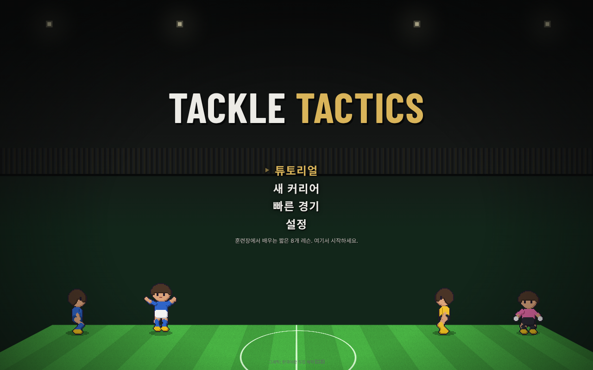
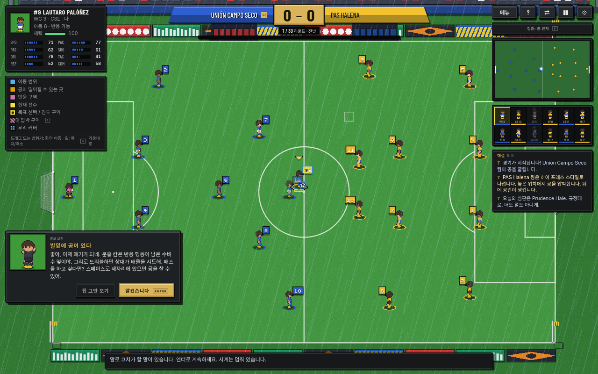
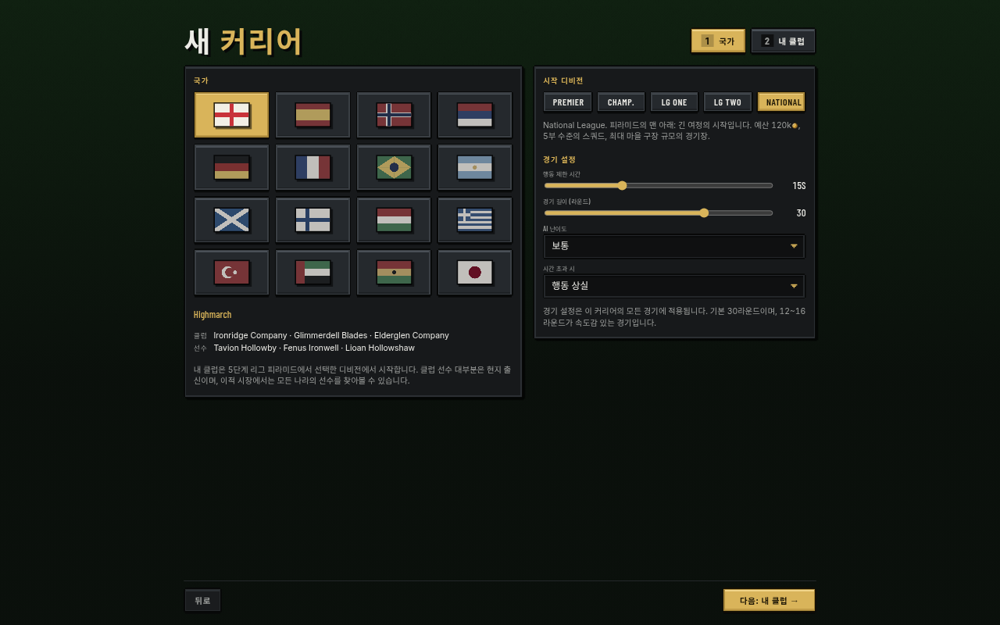

# Tackle Tactics 한국어판 (타클 택틱스)

> 원작: [IamSebastianDev/tackle-tactics](https://github.com/IamSebastianDev/tackle-tactics) (코드 MIT) · 원문 README는 [`README.en.md`](README.en.md)

축구 유니폼을 입은 **턴제 위치 선점 전술 게임**입니다. 22명의 선수가 빠른 순서대로 한 명씩 움직이는 50 × 30 격자 위에서
공간을 만들고, 공간을 막고, 제한 시간과 싸웁니다. 한 경기만 하는 빠른 경기(AI 대전, 2인 번갈아 하기, AI 대 AI)와,
5단계 × 10팀 리그 피라미드를 올라가는 커리어(훈련, 멀티클래스, 이적, 부상, 노화, 스토리, 경기 준비)를 지원합니다.

## 스크린샷

| 타이틀 | 경기 | 새 커리어 |
| --- | --- | --- |
|  |  |  |

(실제 배포 빌드를 직접 실행해 캡처한 화면입니다.)

## 이 한국어판에서 달라진 점

- **화면에 보이는 모든 글자를 한국어로 번역**: 타이틀, 튜토리얼 8개 레슨, 경기 화면, 커리어 허브, 설정, 도움말, 코치 팁, 해설.
  브랜드명 "Tackle Tactics", 코치 이름(말로 코치)은 유지했고, 가상의 선수·구단·국가 이름은 원문(영문) 그대로 둡니다.
- 한글 글꼴(Noto Sans KR) 포함.
- **그래픽을 새로 직접 제작**: 선수·키퍼·코치 스프라이트, 잔디 타일, 공, 골대와 골망, 관중, 광고판, 조명탑, 더그아웃, 코너 플래그, 트로피를
  코드로 그려 만들었습니다 (`scripts/art/`). 생성 스크립트는 외부 이미지 파일을 읽거나 복사하지 않습니다.
  덕분에 원작에서 따로 구해야 했던 유료 그래픽 팩 없이 바로 실행됩니다.
- 경기 중 애니메이션(킥, 슬라이딩 태클, 키퍼 캐치·펀치, 세리머니, 헤딩, 지친/슬픈 모습)을 직접 확인하며 보완했습니다.

## 실행

Node 22 이상이 필요합니다.

```bash
npm install
npm run dev        # http://localhost:5173
npm run build      # dist/ 로 웹 빌드
npm test           # vitest
```

데스크톱 앱(Tauri)은 Rust 도구가 있을 때 `npm run desktop`으로 실행합니다. 자세한 개발 설명은 [`README.en.md`](README.en.md)를 보세요.

## 조작

| 키 | 동작 |
| --- | --- |
| 클릭 | 이동 / 조준 / 대상 선택 |
| Space | 제자리 대기, 턴 종료, 공 지키기 |
| 1–9 | 특수 능력 (카드에 마우스를 올리면 미리보기) |
| T | 태클 |
| A | 이번 행동을 AI에게 맡기기 |
| F | 집중: 지시할 선수 범위 (전체 / 공 근처 / 핵심 대결) |
| Z | 압박 구역 표시 켜기·끄기 |
| P | 일시정지 |
| 휠, + / − / 0 | 확대 / 축소 / 초기화 |
| C | 시점 중앙으로 |
| H | 플레이북 · M 음소거 · Esc 취소 |
| B | 벤치와 교체 |
| F11, ⌘/Ctrl+Enter | 전체 화면 |

## 기술 정보

- 웹 앱: TypeScript, Vite, [Nørd](https://www.npmjs.com/package/@grainular/nord). UI는 1600×900 고정 무대를 창 크기에 맞춰 확대합니다.
- 경기 엔진(`src/engine/`)은 DOM을 모르는 순수 턴 엔진이고, AI(`src/ai/brain.ts`)는 휴리스틱입니다.
- 모든 수치는 `src/config.ts`에 있습니다. 한글 UI 문자열은 화면 파일(`src/ui/`)과 메타 로직(`src/meta/`)에 들어 있습니다.
- 그래픽 생성 스크립트: `scripts/art/` (Python + Pillow). 사용법은 [`scripts/art/README.md`](scripts/art/README.md).
- 빌드 시 수천 개의 스프라이트 조각은 `cast.pack` 한 파일로 묶입니다(호스팅 파일 수 제한 대응).

## 알려진 한계

- 엔진 내부 로그 문자열 일부(화면에는 표시되지 않음)는 영어입니다.
- 라디오(노래)는 원작에서도 저장소에 없는 곡 파일이 필요해 이 판에는 포함되지 않았습니다. `assets/music/`에 곡을 넣으면 원작처럼 동작합니다(미검증).
- 키퍼의 '다이브' 단독 동작은 게임에서 사용되지 않아 별도로 만들지 않았습니다.

## 라이선스와 크레딧

- 코드: [MIT](LICENSE) (원작자 Sebastian Heinz). 이 저장소의 번역 변경분도 같은 조건입니다.
- 그래픽(`public/assets/`): 이 한국어판에서 직접 제작한 그래픽입니다. 별도 라이선스는 아직 지정하지 않았으며(재사용 조건 미정), 원작이 사용한 bubbabba의 유료 팩 파일은 포함하지 않습니다. 원작 코드의 MIT는 이 그래픽에 자동 적용되지 않는 것으로 취급합니다.
- 글꼴(코드·그래픽과 별개): Barlow Condensed, Inter, Silkscreen, Pixelify Sans, VT323, Noto Sans Symbols, Noto Sans KR (SIL Open Font License, Fontsource 경유).
- 원작: [github.com/IamSebastianDev/tackle-tactics](https://github.com/IamSebastianDev/tackle-tactics) · 클럽, 선수, 국가, 리그는 모두 가상입니다.
